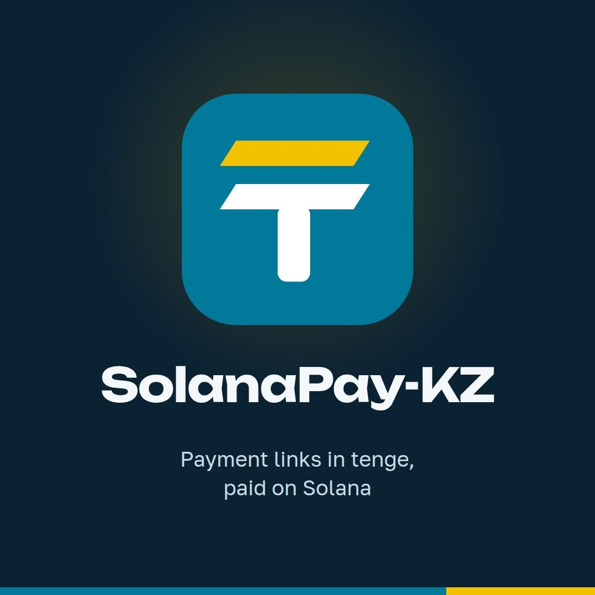
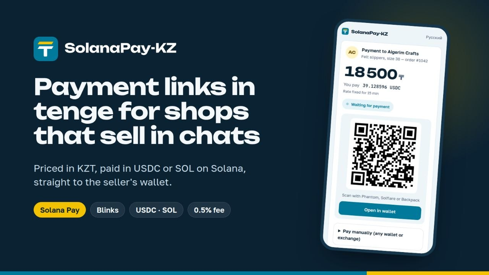

<p align="center"></p>

# SolanaPay-KZ — payment links in tenge, paid on Solana

[](https://github.com/Tatancloud/solanapaykz/actions/workflows/tests.yml)
[](https://www.npmjs.com/package/@solanapaykz/core)
[](LICENSE)
[](https://solana.com)
[](https://colosseum.com)

**English** · [Русский](README.ru.md)

> An open-source toolkit that lets shops in Kazakhstan accept payment in **USDC** and **SOL** on Solana while showing
> prices in **tenge (KZT)**. Money moves straight from the buyer's wallet to the merchant's wallet — nothing in this
> project holds, routes or can freeze it, and private keys are never requested, created or stored.

[Live app](https://solanapaykz.site/) · [Pitch video](https://youtu.be/QwVEPey9PfY) · [Demo video](https://youtu.be/Jy2tIG_G8oA) · [Docs](https://tatancloud.github.io/solanapaykz/) · [npm](https://www.npmjs.com/package/@solanapaykz/core)

---



---

## Submission to Colosseum — Crypto World's Fair (Sept–Oct 2026)

| Name | Role | Contact |
|------|------|---------|
| Ruslan Satybaldin | Solo founder | [Telegram](https://t.me/RuslanUralsk) · [X](https://twitter.com/ruslantatankz) · [LinkedIn](https://www.linkedin.com/in/ruslansatybaldin/) |

10+ years in IT, client work and B2B sales in fintech, banking and a private medical laboratory.

---

## Problem and Solution

A small shop in Kazakhstan that wants to accept stablecoins faces three obstacles at once.

### 1. No direct rate
- **Problem:** No exchange quotes crypto against the tenge except one pair. The widely recommended price APIs do not
  support KZT at all — one of them answers a KZT request with HTTP 200 and an empty object, which a naive
  implementation reads as a rate of zero.
- **SolanaPay-KZ:** computes the rate from the one pair that exists (Binance USDT/KZT) and freezes the amount with the
  order for 15 minutes.

### 2. No ready integration
- **Problem:** Shop platforms ship card gateways, not wallets — and many sellers have no website at all and sell in
  WhatsApp, Instagram or Telegram.
- **SolanaPay-KZ:** ready integrations for WooCommerce and Tilda, a TypeScript SDK for everyone else, and **chat
  payment links** priced in tenge that a seller pastes into any chat.

### 3. Custody
- **Problem:** Most crypto payment services take the money first and settle later, which is exactly what a small
  merchant cannot risk.
- **SolanaPay-KZ:** never touches the money. The buyer pays the seller's own wallet; the 0.5% service fee is taken
  inside the same transaction. The only thing the code does with funds is *look* at them.

---

## Why Solana

- **Solana Pay** — an open standard for payment requests and QR codes, so any Solana wallet (Phantom, Solflare,
  Backpack) can pay a link without a custom app
- **Transaction requests** — the server builds the exact transaction, so the seller's payment and the 0.5% fee arrive
  together in one transfer
- **Blinks (Solana Actions)** — the same payment link unfolds into a pay button on X
- **USDC** — a dollar stablecoin native to the network, so a price in tenge is not exposed to crypto volatility
- **Speed and cost** — a payment confirms in seconds for a fraction of a cent, which makes small chat orders viable

---

## Summary of Features

- Chat payment links priced in tenge, paid in USDC or SOL — one tap from a wallet, by QR, or as a Blink on X
- Manual payment from any wallet or exchange, matched by a unique amount
- 0.5% fee split on-chain inside the payment; for manual payments it is recorded as owed and repaid from the dashboard
- Merchant accounts with email or wallet sign-in, a dashboard, CSV export and email notifications
- Telegram bot for sellers
- WooCommerce plugin and a payment server for Tilda shops
- `@solanapaykz/core` SDK: quote, payment request and verification for Node.js 20.18+ and the browser
- English and Russian interface

---

## What is built

| Component | For | Tests | Status |
|---|---|---|---|
| [`@solanapaykz/core`](https://www.npmjs.com/package/@solanapaykz/core) | developers on any platform | 129 | published on npm |
| [WooCommerce plugin](https://tatancloud.github.io/solanapaykz/woocommerce) | WordPress shops | 222 | [released](https://github.com/Tatancloud/solanapaykz/releases/tag/v0.1.0) |
| [Tilda server](https://tatancloud.github.io/solanapaykz/tilda) and [chat payment links](docs/links.md) | Tilda shops, sellers in chats | 420+ | [solanapaykz.site](https://solanapaykz.site/) · [Tilda demo](https://kzwedding.tilda.ws/solanapay) |

770+ automated tests across three languages, plus end-to-end verification with real payments on Solana devnet.

---

## Tech Stack

| Layer | Technology |
|-------|-----------|
| SDK | TypeScript · `@solana/kit` · `@solana/pay` · `@solana-program/token` |
| Payment server and links app | Node.js 22 · `node:http` · `node:sqlite` · server-rendered pages |
| WooCommerce plugin | PHP 8.1 · `bcmath` |
| Rates | Binance USDT/KZT |
| Infrastructure | Docker · nginx · GitHub Actions · GitHub Pages (docs) |
| Testing | Vitest · PHPUnit · devnet end-to-end |

---

## Architecture

```
buyer                     shop                      Solana
  │                        │                          │
  │   places an order  ──> │                          │
  │                        │ rate: Binance USDT/KZT   │
  │                        │ amount frozen for 15 min │
  │  <── QR code / link ── │                          │
  │                                                   │
  │  ─────────── pays directly from own wallet ─────> │
  │                        │                          │
  │                        │ ── checks the chain ──>  │
  │  <── order confirmed ──│                          │
```

The shop never holds the buyer's money and the project never holds the shop's.

**Chat payment links.** Sellers who trade in WhatsApp, Instagram or Telegram create a payment link priced in tenge
and paste it into the chat. The buyer pays USDC or SOL in one tap (Solana Pay transaction request), by a manual
transfer from any wallet or exchange, or as a Blink. Funds go straight to the seller's own wallet; the service takes
0.5% inside the same transaction and never holds funds or keys. See [docs/links.md](docs/links.md).

### Design decisions worth knowing

These are the choices that cost the most to get wrong, and each is enforced by tests:

- **Money is integer arithmetic, never floating point.** Amounts are carried as strings and computed in the token's
  minimal units.
- **Rounding is always in the merchant's favour**, to the last digit the coin has — six decimals for USDC, nine for SOL.
- **A network failure never changes an order.** If the Solana node is silent, the order stays as it was. Silence is
  not an answer of "no payment".
- **An amount mismatch is never resolved automatically.** A payment that exists but does not add up is handed to a
  human, because blockchain transfers are irreversible and automation errs more expensively than a person here.
- **The price is frozen with the order** — amount, recipient, network and payment reference — and never recomputed
  during verification.

---

## Quick Start

**Prerequisites:** Node.js 22, npm; PHP 8.1 with `bcmath` for the WooCommerce plugin; your own Solana RPC endpoint.

```bash
# Clone the repository
git clone https://github.com/Tatancloud/solanapaykz
cd solanapaykz

# SDK: install, test, build
npm install
npm test
npm run build

# Tilda server and chat payment links
cd tilda-server
npm install
npm test
cp config.example.json config.json   # set your RPC, wallets and SMTP
npm run build && npm start
```

Docker setup of the server: [`tilda-server/docker-compose.yml`](tilda-server/docker-compose.yml) · Tilda guide:
[docs](https://tatancloud.github.io/solanapaykz/tilda) · WooCommerce plugin: [`demo-shop/plugin/`](demo-shop/plugin/).

### Requirements

- **Own Solana RPC endpoint.** Public nodes are rate-limited and do not keep enough history to find a payment
  reliably. This is a hard requirement, not a recommendation.
- PHP 8.1 with the `bcmath` extension for the WooCommerce plugin.
- Node.js 22 for the library and the Tilda server.
- Shop currency must be KZT.

---

## Repository map

| Path | What it is |
|---|---|
| `src/` | the `@solanapaykz/core` library (TypeScript) |
| `tests/` | its tests |
| `tilda-server/` | payment server for Tilda shops and the chat payment links app (TypeScript, Node 22) |
| `demo-shop/plugin/` | WooCommerce plugin (PHP 8.1) |
| `demo-shop/` | Docker setup of the demo shop |
| `docs/` | the public documentation site (GitHub Pages) |
| `process/` | how this was built: brief, specifications, plans, code map |
| `assets/` | logo and poster |

`process/` is unusual for a repository and deliberate: it holds the design documents, the implementation plans and
the review findings that shaped the code. Anyone judging the engineering can read the reasoning, not just the result.

---

## Prior work disclosure

Before the contest period (2026-09-14) this repository already contained the core SDK, the WooCommerce plugin and a
single-merchant Tilda payment server — release [`v0.1.0`](../../releases/tag/v0.1.0) (2026-09-13). Everything after
that tag was built during the hackathon: multi-merchant accounts, email and wallet sign-in, chat payment links,
the on-chain fee split, manual exchange payments with unique amounts, Solana Actions (Blinks), the merchant
dashboard, the fee ledger and the Telegram bot. Full diff: [`v0.1.0...main`](../../compare/v0.1.0...main).

---

## Roadmap

- [x] `@solanapaykz/core` SDK published on npm
- [x] WooCommerce plugin and Tilda payment server (v0.1.0)
- [x] Chat payment links, Blinks, manual exchange payments, merchant dashboard, Telegram bot
- [ ] Partner with a licensed AIFC provider to accept SOL/USDC on Solana and settle merchants in tenge
- [ ] Settlement mode in the product: route payments to the partner's address with a merchant identifier
- [ ] More local currencies (the quote engine already prices from fiat)
- [ ] Optional on-chain splitter program so manual payments also pay the fee on-chain

### Legal status

Kazakhstan currently does not allow crypto-assets to be used as payment for goods and services; the legal route is
conversion to tenge through a licensed provider (since July 2026 the National Bank's unified QR accepts crypto
wallets with conversion through AIFC exchanges). This project lets merchants receive to their own wallets and is
demonstrated on mainnet with team-owned test merchants and pilot merchants recruited by the team.

---

## Resources

- [Live application](https://solanapaykz.site/)
- [Pitch video](https://youtu.be/QwVEPey9PfY)
- [Product demo video](https://youtu.be/Jy2tIG_G8oA)
- [Documentation](https://tatancloud.github.io/solanapaykz/)
- [Live WooCommerce demo shop](https://shop.pagafox.kz)
- [Live Tilda demo shop](https://kzwedding.tilda.ws/solanapay)
- [X / Twitter](https://twitter.com/ruslantatankz) · [Telegram](https://t.me/RuslanUralsk)

---

## License

MIT — see [LICENSE](LICENSE). Free to read, use and modify, including commercially.
